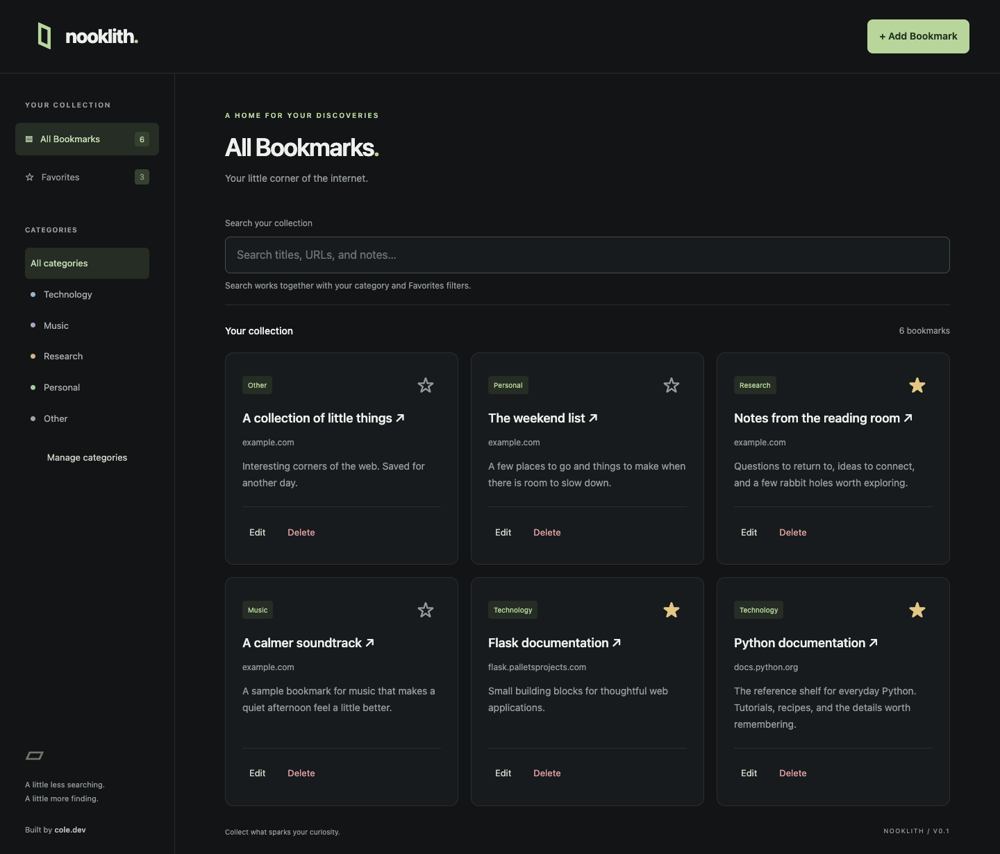
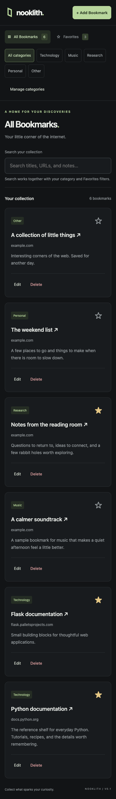
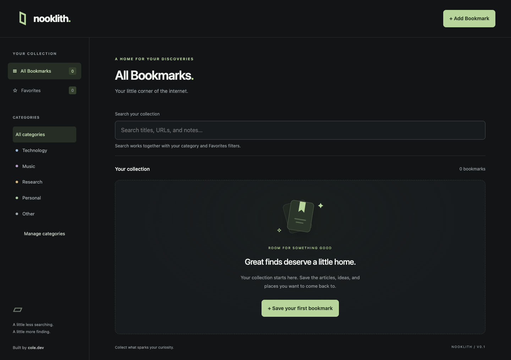
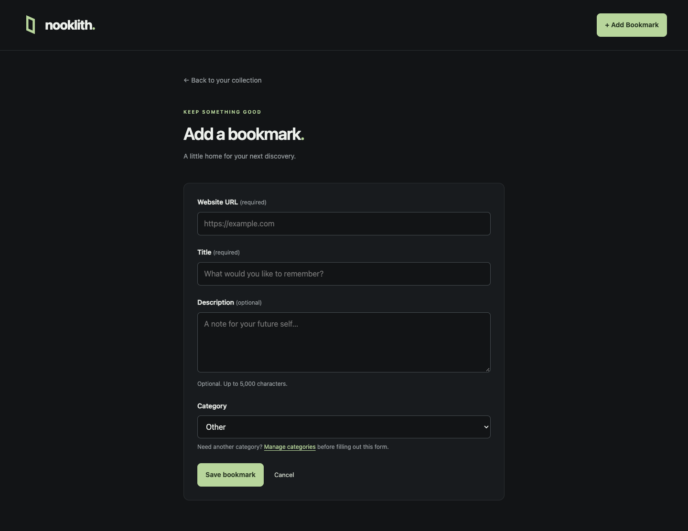

# Nooklith

**Your little corner of the internet.** Built by Cole.dev.

A lightweight personal bookmark manager built with Python, Flask, Flask-SQLAlchemy,
SQLite, and Jinja2, with custom responsive CSS and vanilla JavaScript. Save the
articles, ideas, and places you want to come back to—without accounts or external
services. The core application is complete through **Phase 5 — Portfolio readiness**.

## Screenshots



<details>
<summary>Mobile dashboard, empty state, and bookmark form</summary>







</details>

Screenshots use demo data in a temporary database. The installed application
starts empty. Regenerate them with the browser-test command below.

## Technology

Python 3.12+, Flask, Flask-SQLAlchemy, SQLite, Jinja2, Flask-WTF for CSRF protection,
HTML5, CSS3, and vanilla JavaScript. Development tools: uv, pytest, Playwright,
Node.js's built-in test runner, and Git. No frontend framework or build step.

## Available now

- Dark, responsive dashboard with Nooklith branding and a friendly empty state.
- Persistent Bookmark model with title, URL, description, category, favorite status,
  and automatic creation/update timestamps.
- Automatic database creation on application startup.
- Create and edit bookmarks with URL, title, description, and category.
- Add and delete your own categories; deleting a category preserves its bookmarks.
- Delete bookmarks with confirmation, including a JavaScript-free fallback.
- Saved bookmarks display newest first, with safe external links.
- Server-side validation and CSRF protection on every state-changing request.
- Instant case-insensitive search across titles, full URLs, and descriptions.
- Category and Favorites filters that combine with search, with result counts
  and a clear-filters action when no bookmarks match.
- Persistent favorites with accessible star buttons and network error feedback.
- Accessible focus states, semantic markup, and a custom 404 page.
- Larger tap targets, wrapping mobile category controls, and consistent card spacing.
- Linked validation summaries with keyboard focus, clear active-filter context,
  and saving feedback for favorites. Hover transitions respect reduced motion.

Website title fetching is deferred to Phase 6. No website is fetched when you
save a URL. Playwright is a development-only dependency, used for tests and screenshots.

## Install and run

Requires Python **3.12 or newer**. `.python-version` selects **3.13** for reproducible
local development; uv can install it if needed.

Install uv using the instructions at <https://docs.astral.sh/uv/getting-started/installation/>.
On macOS with Homebrew, run `brew install uv`.

Clone the repository, then synchronize dependencies and start the application:

```bash
git clone https://github.com/michealcoleyoung/nooklith.git
cd nooklith
uv sync
uv run python run.py
```

Open <http://127.0.0.1:5000>. No manual environment activation is needed.
Stop the server with Ctrl+C. The SQLite database is created automatically at
`instance/nooklith.db` and persists between restarts. This directory is ignored by Git.

The application binds to loopback and runs without debug mode. Version 1 is for
local, single-user use: it has no authentication and should not be exposed to an
untrusted network or the public internet.

## Usage

Choose **Add Bookmark**, enter an HTTP/HTTPS URL and title, optionally add a note
and category, then save. New bookmarks appear on the dashboard immediately.
Choose **Edit** on a card to update its details, or **Delete** and confirm to
permanently remove it. Cancel leaves your collection unchanged.

### Your own categories

Select **Manage categories** in the dashboard sidebar or bookmark form. Enter a
name and choose **Add category**. It becomes available in bookmark forms and
category filters immediately. Names contain 1–50 characters; surrounding and
repeated whitespace are normalized, and case-insensitive duplicates are rejected.

To remove one, choose its **Delete** button and confirm on the next page.
Bookmarks in that category move to **Other**, keeping their URLs, notes, and
favorite status. **Other** is the permanent fallback and cannot be deleted.
You can delete the other starter categories as well as your own. Deleted
categories stay deleted after restarting the app.

Existing installations upgrade automatically at startup: the app adds a category
table and imports the starter categories and any existing bookmark categories.
Bookmark records are preserved. No manual migration or extra dependency is needed
for this change. Create categories before filling out a bookmark form; following
the management link does not save an unfinished form.

### Search and favorites

Type in **Search your collection** to filter as you type. Choose a category to
narrow results, and **Favorites** to show only starred bookmarks within that
category. **All categories** clears the category; **All Bookmarks** clears the
category and Favorites filters while keeping your search. **Clear search and
filters** resets everything from the filter summary or no-results state.

Select a star to toggle a favorite. The star updates once saving succeeds, and
the choice survives refreshes. If a request fails, follow the displayed refresh
instruction to check the saved state. Search and filters require JavaScript;
bookmark management and favorite forms also work without it.

URLs are trimmed, schemes and hostnames lowercased, internationalized hostnames
converted to IDNA, default ports removed, and empty paths normalized to `/`.
Embedded credentials, malformed hostnames, whitespace, backslashes, and non-web
schemes are rejected. Titles are limited to 255 characters, URLs to 4,096, and
descriptions to 5,000. URL validation checks syntax, not whether a website exists.

## Tests

```bash
uv run pytest
```

Tests use temporary SQLite databases, separate from personal bookmarks. They check
the homepage, empty state, database defaults and persistence across app instances,
escaped rendering, safe link handling, CRUD operations, validation, confirmation,
missing routes/records, and CSRF rejection. CSRF remains enabled during tests.
Favorite tests also verify toggling, persistence, and the non-JavaScript fallback.

Run the dependency-free JavaScript behavior tests with Node.js (18 or newer):

```bash
node --test tests/test_dashboard.js
```

These tests exercise combined filtering and favorite request outcomes using a
simulated DOM. They do not replace a visual browser check on desktop and mobile.

### Real browser tests and screenshots

With Google Chrome installed, run:

```bash
uv run pytest --browser
```

Browser tests use a temporary database, an ephemeral loopback server, and an
isolated browser profile. They cover combined filters, favorite persistence and
failure feedback, CRUD, delete cancellation, validation focus, keyboard navigation,
JavaScript-free forms, and overflow at desktop, tablet, 390px, and 320px widths.
The default `uv run pytest` skips these six opt-in tests so normal testing does
not require a browser.

To use Playwright's Chromium instead of an installed Chrome:

```bash
uv run playwright install chromium
uv run pytest --browser --browser-channel chromium
```

To refresh the four tracked screenshots with demo data:

```bash
uv run pytest --browser --screenshots tests/test_browser.py
```

Chrome browser checks and screenshot inspection were performed during portfolio
preparation. This does not establish cross-browser or screen-reader compatibility.

### Manual interface checks

- At desktop, tablet, and mobile widths (including 320px), check the dashboard,
  populated cards, empty state, and add/edit forms for overflow and readable text.
- Use Tab and Shift+Tab to reach navigation, filters, stars, and card actions;
  verify focus remains visible. Activate the skip link to reach the main content.
- Combine search, a category, and Favorites; check the context, count, and reset.
- Submit invalid form data and follow the error-summary links to the fields.
- Toggle favorites, including removing the final visible favorite; verify feedback
  and keyboard focus. Check failure feedback with the browser's offline mode.
- Enable reduced motion and confirm hover transitions are disabled. Disable
  JavaScript to check CRUD, delete confirmation, and favorite form fallbacks.

Keep these checks for changes to the interface. A screen-reader review and tests
in Safari and Firefox remain future verification work.

## Project layout

```text
app/                 Flask factory, model, routes, templates, CSS, vanilla JS
tests/               Flask, accessibility, JavaScript, and browser tests
docs/screenshots/    Captured interface with example data
config.py            Default configuration
run.py               Local entry point
pyproject.toml       Metadata and dependencies
uv.lock              Locked dependencies (keep in Git)
```

Use `uv add` for application dependencies and `uv add --dev` for development
dependencies. Commit both `pyproject.toml` and `uv.lock` when changing dependencies.
The app generates a persistent signing key at `instance/secret_key` on first run.
It signs sessions and CSRF tokens and is ignored by Git. To supply your own key,
set `SECRET_KEY` in your shell before starting the application. `.env.example`
documents this option; `.env` is not automatically read. Changing the key
invalidates existing sessions and open forms. Expired forms show a friendly error
and do not change data.

## Known limitations and future improvements

- Local, single-user use only; no authentication or public application deployment.
- Category renaming is not supported; add a new category and edit bookmarks to move them.
- Search and filters run in the browser and reset when the page reloads.
- All bookmarks load together; pagination could help with larger collections.
- `db.create_all()` creates missing tables but does not migrate existing schemas.
- No automatic title retrieval. Optional Phase 6 requires explicit approval and
  robust SSRF protections before any fetch endpoint is introduced.
- Future work could include migration tooling and broader browser/accessibility
  verification. New features remain outside the current scope.

Detailed specifications and the implementation phases are in
[docs/REQUIREMENTS.md](docs/REQUIREMENTS.md).
